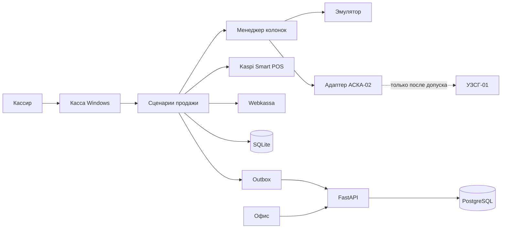

# Архитектура AGZS Control

Статус: учебная касса и центр работают на эмуляторе. Деньги хранятся целыми тенге. АСКА-02, Kaspi и Webkassa по-прежнему закрыты: устройства и контрактов нет.

Связанные документы: [база данных](DATABASE.md), [продажа](SALES_FLOW.md), [колонки и АСКА-02](PUMP_PROTOCOL.md), [план разработки](DEVELOPMENT_ROADMAP.md), [риски](RISKS.md).

## 1. Назначение

AGZS Control автоматизирует операционную работу автомобильной газозаправочной станции и даёт сети станций единый контур учёта. Первая площадка — АГЗС в Казахстане. Расчётный масштаб — до 1000 станций на одном центральном контуре.

Система состоит из двух развёртываемых частей.

| Часть | Где работает | Ответственность |
| --- | --- | --- |
| Локальная касса `station-app` | Windows 10/11, компьютер кассира | Колонки, продажа, Kaspi Smart POS, Webkassa, локальная БД, работа без связи с центром, исходящая синхронизация |
| Центральный сервер `central-server` | Ubuntu, собственный сервер | Организации, станции, пользователи, копии продаж, аналитика, отчёты, мониторинг, RBAC |

Общий пакет `shared` содержит только контракты: перечисления, денежные типы, версии событий синхронизации. В нём нет доступа к оборудованию, к Kaspi и к Webkassa.

На станции используется колонка УЗСГ-01 и адаптер связи АСКА-02. АСКА-02 на момент проектирования нет. Распиновка, кадры, адреса и протокол, включая «Искру 1.72», в проект не закладываются. Обмен с будущим адаптером идёт через порт `PumpPort`. До стенда его закрывает `EmulatorAdapter`. `Aska02Adapter` до отдельного допуска только отказывает в обмене.

## 2. Ограничения, которые архитектура обязана сохранить

1. Графический интерфейс не управляет колонкой. Он вызывает сценарий приложения. Сценарий вызывает менеджер колонок. Менеджер вызывает адаптер.
2. Центральный сервер не отправляет команды пуска, останова и дозирования. Независимо от роли пользователя таких маршрутов нет.
3. Пуск и останов газа на физическом интерфейсе не отправляются, пока не подтверждены протокол, прошивка, стенд и аппаратные защиты. Подробности — в [PUMP_PROTOCOL.md](PUMP_PROTOCOL.md).
4. Если оплата Kaspi не подтверждена, отпуск не разрешается.
5. Если состояние колонки неизвестно или связь с ней потеряна, отпуск не разрешается.
6. Юридическая схема фискализации предоплаты не выбирается в этом проекте. Пока нет утверждённой политики, программный шлюз отпуска закрыт.
7. Платёжный и фискальный адаптеры в промышленном контуре не возвращают успешный результат без реального обмена с провайдером.
8. Адреса серверов, пароли и ключи не хранятся в исходном коде.
9. Аварийный аппаратный останов колонки не зависит от этого ПО и им не подменяется.

## 3. Контекст



Пунктир до УЗСГ-01 означает, что физического обмена сейчас нет. Эмулятор не имеет канала к этому оборудованию.

Kaspi Smart POS и Webkassa вызываются только с кассы. Центр хранит результат, который касса уже зафиксировала, и не проводит оплату или чек за станцию. Так сохраняется локальная работа и не появляется второй контур списания денег.

Данные, которые центр может прислать на станцию: состав станции, цены, пользователи, признак коммерческой блокировки новых продаж, идентификатор утверждённой фискальной политики, параметры мониторинга. Признак блокировки запрещает новые продажи в программе. Он не является командой клапану.

## 4. Стек

| Контур | Технологии |
| --- | --- |
| Касса | Python 3.12+, PySide6, SQLite, SQLAlchemy 2, Alembic, Pydantic 2, pytest |
| Центр | Python 3.12+, FastAPI, PostgreSQL 16, SQLAlchemy 2, Alembic, Docker Compose, Nginx, HTTPS |
| Контракты | Общий пакет без зависимости от UI и от сервера |

Идентификаторы — UUIDv7. Генератор живёт в `shared`. Минимальная версия интерпретатора — 3.12, чтобы касса не зависела от более нового стандартного генератора.

Деньги хранятся целым числом тенге: одна единица равна 1 KZT. Дробный тиын не хранится — единица уточнена перед этапом 2. Объём хранится целым числом миллилитров. Цена хранится целым числом тенге за литр. Числа с плавающей точкой в расчётах продажи не используются. Стоимость отпуска считается целой арифметикой миллилитров и цены и округляется до целого тенге именованной политикой. Идентификатор политики сохраняется на продаже. В промышленном профиле продажа не создаётся, пока политика округления не выбрана явно. Профиль эмулятора подставляет тестовую политику `TEST_HALF_UP` и показывает, что это не нормативное правило.

Время в базах — UTC. Часовой пояс станции — поле IANA в конфигурации станции, а не константа в коде.

## 5. Локальная касса

### 5.1. Слои

```text
ui  →  application  →  domain
                ↓
              ports  ←  adapters
                ↓
           sqlite / sync / security
```

| Слой | Содержимое | Запрещено |
| --- | --- | --- |
| `ui` | Окна PySide6, ввод, отображение снимка состояния | Импорт адаптеров, SQL, команд колонки |
| `application` | Сценарии: продажа, смена, снимок колонок | Прямой обмен с портом АСКА, собственная арифметика «мимо» домена |
| `domain` | Состояния, инварианты, деньги, переходы | PySide, SQLAlchemy, HTTP, последовательный порт |
| `ports` | Протоколы `PumpPort`, `PaymentPort`, `FiscalPort`, репозитории | Реализация вендоров |
| `adapters` | Эмулятор, заглушка АСКА-02, Kaspi, Webkassa | Решение, можно ли продавать |
| `database` | Сессии, репозитории, outbox в той же транзакции | Бизнес-ветвления продажи |
| `sync` | Доставщик outbox, приём конфигурации | Повторная фискализация и повторная оплата |
| `security` | Вход, роли, аудит, ключница | Хранение секрета в SQLite открытым текстом |

Сборка зависимостей находится только в `main.py`. Остальной код получает уже созданные порты.

### 5.2. Модули

**Pump Manager.** Владеет состоянием колонок одного звена связи, очередью команд и журналом. Проверяет переход перед вызовом адаптера. Не знает про Kaspi и Webkassa.

**Pump Adapter.** Изолирует транспорт. `EmulatorAdapter` моделирует колонки в памяти. `Aska02Adapter` до допуска отклоняет и чтение, и управление: чтение включается отдельным флагом после пассивных испытаний, управление — ещё более поздним флагом.

**Sales Core.** Создаёт продажу, замораживает цену, проводит оплату, запрашивает фискальный шлюз, один раз запрашивает допуск к отпуску, принимает факт и фиксирует расхождение. Повторный вызов с тем же `sale_id` возвращает уже созданный результат.

**Payment Adapter.** Порт Kaspi Smart POS. Промышленная реализация не содержит учебного успеха. Контракт провайдера в репозиторий не включён: без конфигурации и без утверждённого контракта старт оплаты завершается ошибкой «интеграция не настроена», отпуск не открывается.

**Fiscal Adapter.** Порт Webkassa плюс политика фискализации. Политика — это выбор уже написанного и проверенного правила по идентификатору, а не описание чека в свободном JSON. Во встроенном наборе есть только правило `DENY_ALL`. Оно закрывает отпуск. Тестовые правила подключаются лишь при `AGZS_ENV=emulator` или `AGZS_ENV=test`.

**Database.** SQLite одной станции. Журнал WAL, внешние ключи, одна очередь записи.

**Sync Service.** Исходящие бизнес-события и входящая конфигурация. Не исполняет команды оборудования.

**Security.** Локальный вход кассира, кэш ролей, журнал аудита, доступ к системной ключнице Windows.

### 5.3. Потоки

| Поток | Владеет | Не делает |
| --- | --- | --- |
| UI | Окна и сигналы Qt | Не читает порт и не пишет в SQLite напрямую |
| Секвенсор звена | Одна активная операция обмена на звено | Не ведёт две транзакции шины параллельно |
| Запись БД | Единственный писатель SQLite | Не вызывает адаптеры из-под блокировки БД |
| Синхронизация | Outbox и версия конфигурации | Не меняет статус оплаты без события домена |

Снимок для интерфейса публикует менеджер колонок. Интерфейс читает снимок. Он не опрашивает адаптер.

Команда адаптеру уходит только после фиксации намерения в базе. Падение процесса не приводит к слепому повтору пуска: при старте сценарий восстанавливает агрегаты и сверяет неизвестные платежи, чеки и отпуск. Повторный пуск при статусе попытки `UNKNOWN` запрещён, пока пассивное чтение или ответ провайдера не снимет неизвестность.

### 5.4. Сборка профилей

| `AGZS_ENV` | Колонки | Оплата | Фискализация |
| --- | --- | --- | --- |
| `production` | `aska02`, управление выключено, пока нет акта допуска | Только боевой адаптер Kaspi | Только утверждённая политика; иначе `DENY_ALL` |
| `emulator` | Только `EmulatorAdapter` | Тестовый порт, без сети Kaspi | Тестовая политика, без сети Webkassa |
| `test` | Эмулятор | Подмена в тестах | Подмена в тестах |

Промышленный корень сборки не импортирует тестовые порты. Отдельный тест сборки проверяет это правило. Профиль `production` с драйвером `emulator` не запускается. В заголовке окна эмулятора постоянно видна надпись, что это не касса и расчёты с покупателем не проводятся.

Секреты промышленного профиля читаются из Диспетчера учётных данных Windows (`keyring`). В SQLite и в файлах конфигурации лежат идентификаторы параметров, а не сами секреты.

### 5.5. Интерфейс кассира

Главный экран показывает все колонки станции: внутренний номер, название, статус, цену за литр, текущие литры, текущую сумму, состояние оплаты. Отдельные индикаторы показывают звено колонок, Kaspi, Webkassa и связь с центром. Потеря центра не блокирует экран.

Предусмотрены выбор колонки, ввод суммы предоплаты, окно ожидания оплаты, окно результата, история операций, открытие и закрытие смены, настройки станции по роли, журнал инцидентов.

Окно эмулятора доступно только в профиле `emulator`: включение виртуальной колонки, скорость отпуска, авария, обрыв звена, одновременная работа нескольких колонок. Это окно вызывает тестовый порт эмулятора через сценарий приложения, а не через драйвер АСКА-02.

Настройки промышленной станции не переключают драйвер на эмулятор.

## 6. Несколько колонок

Проектный ориентир — до 6 колонок на одну АСКА-02. Фактическое число каналов станет параметром звена после обследования устройства. Модель сразу допускает несколько звеньев на станцию, хотя первый пуск рассчитан на одно.

У каждой колонки собственное состояние и собственная текущая продажа. Несколько колонок могут одновременно находиться в `DISPENSING`. Параллельность относится к состоянию. Физический обмен одного звена выполняется строго по одной транзакции за раз: секвенсор не выпускает следующий запрос, пока предыдущий не завершился ответом, отказом или таймаутом. Так исключается наложением команд, даже если протокол окажется полудуплексным. Если документация позже докажет безопасную параллельность, это будет отдельное решение. До того секвенсор остаётся последовательным.

Приоритет очереди одного звена:

| Приоритет | Операция |
| --- | --- |
| 0 | Локальная защёлка программной блокировки новых команд. До допуска это не кадр останова: кассир пользуется аппаратной кнопкой |
| 1 | Опрос колонок в `DISPENSING` |
| 2 | Допуск отпуска и иные команды управления, если флаг управления включён |
| 3 | Опрос остальных колонок |
| 4 | Чтение суммарных счётчиков |

Таймаут транзакции переводит качество наблюдения в `UNKNOWN`, публичный статус колонки — в `OFFLINE`, новые отпуски на этом звене закрываются. Уже идущий отпуск программа второй командой не «дожимает».

Подробный автомат и план АСКА-02 — в [PUMP_PROTOCOL.md](PUMP_PROTOCOL.md).

## 7. Продажа

Основной сценарий — предоплата суммы. У продажи независимые оси: заказ, оплата, фискализация, отпуск, расчёт расхождения, синхронизация. Повторное списание, повторный чек и повторный пуск блокируются уникальными ключами идемпотентности. Полные сценарии — в [SALES_FLOW.md](SALES_FLOW.md).

Объём, которым закрывается продажа, берётся из дельты суммарного счётчика адаптера, а не из отдельного интегратора в интерфейсе. В эмуляторе источник счётчика — сам эмулятор. Отрицательная или неправдоподобно большая дельта переводит продажу в ошибку и не считается суммой к оплате.

Команд калибровки и программирования метрологии в системе нет.

## 8. Работа без интернета

Потеря связи с центром не останавливает кассу. Продажа и события пишутся в SQLite. В той же транзакции создаётся запись outbox. Доставщик отправляет пачку на центр. Центр подтверждает событие по паре `(station_id, event_id)` и при повторе отвечает `DUPLICATE`, не создавая вторую продажу.

Отсутствие связи с Kaspi блокирует отпуск: неподтверждённую оплату нельзя заменить локальной отметкой. Отсутствие свежего состояния колонки блокирует отпуск так же.

Связь с Webkassa зависит от утверждённой политики. Пока политики нет, шлюз закрыт и офлайн-режим сам по себе отпуск не открывает.

Входящая синхронизация подтягивает конфигурацию по монотонной ревизии. Станция применяет ревизию один раз. Команд оборудованию во входящем канале нет.

Локальная копия SQLite до успешной синхронизации — единственный носитель продажи. Поэтому с этапа продаж включается ежедневная согласованная копия через API резервного копирования SQLite.

## 9. Центральный сервер

### 9.1. Состав

Сервисы Docker Compose: PostgreSQL 16, приложение FastAPI, Nginx. Порт PostgreSQL наружу не публикуется. Nginx принимает HTTPS и перенаправляет HTTP. Секреты приходят из переменных окружения на сервере, файл с ними не коммитится.

### 9.2. Изоляция

Каждая коммерческая строка несёт `organization_id`. Станция принадлежит одной организации. Пользователь работает в организациях, явно ему назначенных. Репозиторий центра фильтрует организацию из контекста запроса. Дополнительно в PostgreSQL включается row-level security: прикладная роль видит строки своей организации, отдельная роль платформы используется для сопровождения. Запрос без установленного контекста организации не возвращает коммерческие данные.

Идентификатор станции на кассе совпадает с идентификатором станции в центре.

### 9.3. Внешний API

Префикс `/api/v1`. Ошибки — `application/problem+json`. Изменяющие запросы, которые могут повториться, требуют ключ идемпотентности.

| Группа | Назначение |
| --- | --- |
| `POST /auth/login`, `refresh`, `logout` | Вход сотрудников офиса и администраторов |
| `POST /sync/batches` | Приём событий станции |
| `POST /sync/heartbeat` | Пульс и снимок состояний |
| `GET /sync/config` | Конфигурация новее ревизии |
| Организации, станции, колонки, пользователи, роли | Учёт сети |
| Отчёты и мониторинг | Чтение уже принятых данных |
| `PUT` цен станции | Коммерческие цены, применяются к новым продажам |

Маршрутов пуска, останова, дозирования и сброса колонки нет. Проверка состава маршрутов входит в тесты этапа сервера.

Аутентификация кассы — долгоживущий случайный токен устройства, выданный по одноразовому коду сопряжения. На сервере хранится только хеш токена. На кассе токен лежит в ключнице. Обмен только по HTTPS. Целевое усиление — mTLS, отдельным этапом, без смены прикладных сообщений.

Вход по паролю ограничивается: после серии неудач пара «учётная запись + адрес» временно блокируется. Пароли сотрудников хранятся как Argon2id.

### 9.4. Роли

| Роль | Контур | Смысл |
| --- | --- | --- |
| `cashier` | Касса | Продажа и своя смена |
| `senior_cashier` | Касса | Смена, просмотр чужих операций станции |
| `station_manager` | Касса и офис | Настройки станции, цены в рамках прав, разбор расхождений |
| `technician` | Касса | `MAINTENANCE`, журнал звена; без возвратов и без пуска газа |
| `org_admin` | Офис | Пользователи и станции организации |
| `auditor` | Офис | Чтение и аудит |
| `platform_admin` | Офис | Сопровождение платформы, без команд колонке |

Разрешения задаются отдельно от ролей: продажа, смена, возврат, обслуживание колонки, настройки, цены, отчёты, пользователи, аудит. Роль — набор разрешений. Проверка стоит на сценарии, а не только на кнопке.

### 9.5. Наблюдаемость и сохранение

Структурированный журнал без номеров карт, паролей, токенов и тел платёжных запросов. Корреляция по `sale_id`.

`GET /health` не требует входа. Журнал аудита и фискальные записи прикладная роль не удаляет.

Резервное копирование PostgreSQL включается вместе с первым развёртыванием сервера, до боевых продаж: ежедневный `pg_dump` в отдельный том, архив WAL, копия не на том же диске, что и данные, и учебное восстановление. Повторная проверка восстановления входит в подготовку к эксплуатации.

Расчётная нагрузка 1000 станций — это редкие пачки продаж и короткие пульсы со случайным сдвигом, а не непрерывный поток команд. Отчёты читают те же таблицы с ограничениями по организации, станции и времени. Отдельная реплика чтения и помесячное секционирование продаж не входят в первую схему и подключаются, если измерения это покажут.

## 10. Каталоги

Запрошенное дерево сохранено. Уточнения нужны, чтобы касса не тянула серверные зависимости, а контракт синхронизации не разошёлся в двух копиях.

```text
agzs-control/
├── docs/
├── shared/
│   └── agzs_shared/
│       ├── enums.py
│       ├── money.py
│       └── events.py
├── station-app/
│   ├── pyproject.toml
│   ├── alembic/
│   └── agzs_station/
│       ├── main.py
│       ├── config.py
│       ├── ui/
│       ├── application/
│       ├── domain/
│       ├── pumps/
│       │   ├── manager.py
│       │   ├── models.py
│       │   ├── states.py
│       │   ├── sequencer.py
│       │   └── adapters/
│       │       ├── base.py
│       │       ├── emulator.py
│       │       └── aska02.py
│       ├── sales/
│       ├── payments/
│       ├── fiscal/
│       ├── database/
│       ├── sync/
│       └── security/
├── central-server/
│   ├── pyproject.toml
│   ├── Dockerfile
│   ├── alembic/
│   └── agzs_server/
│       ├── main.py
│       ├── api/
│       ├── auth/
│       ├── stations/
│       ├── sales/
│       ├── users/
│       ├── reports/
│       ├── sync/
│       └── monitoring/
├── deploy/
│   ├── nginx/
│   └── backup/
├── tests/
│   ├── unit/
│   ├── integration/
│   └── emulator/
├── docker-compose.yml
├── .env.example
└── README.md
```

`deploy/` отделяет Nginx и резервное копирование от пакета Python. `aska02.py` до этапа оборудования — заглушка, которая сообщает «обмен не допущен». Она не содержит кадров протокола.

Тесты оборудования в CI не открывают последовательные порты и не монтируют `/dev`.

## 11. Контракты модулей

Ниже — границы вызовов, а не реализация.

```text
PumpPort
  driver_id
  supports_passive_read
  supports_control
  probe() -> LinkStatus
  read_status(address) -> Telemetry
  read_totalizer(address) -> Totalizer
  authorize(command) -> AdapterResult
  read_authorization(command_id) -> AdapterResult
```

`authorize` на адаптере, у которого `supports_control` ложно, завершается отказом и не обращается к порту. `read_status` при выключенном пассивном чтении тоже завершается отказом.

```text
PaymentPort
  start(attempt) -> AttemptStatus
  query(attempt) -> AttemptStatus
  reverse(attempt) -> AttemptStatus | NOT_SUPPORTED

FiscalPolicy
  evaluate(sale) -> GateDecision
  steps_for(sale, moment) -> tuple[StepId, ...]

FiscalPort
  submit(step) -> FiscalDocumentStatus
  reconcile(idempotency_key) -> FiscalDocumentStatus
```

`StepId` выбирается только из правил, которые поставляются с версией программы и покрыты тестами. Неизвестное правило закрывает шлюз.

```text
SalesService
  begin_prepay(pump_id, amount_kzt) -> Sale
  take_payment(sale_id) -> Sale
  open_dispense_gate(sale_id) -> Sale
  record_dispense_progress(snapshot) -> Sale
  finish_sale(sale_id) -> Sale
```

`PumpManager` принимает уже проверенный запрос на допуск и сам повторно проверяет состояние колонки и единственность подтверждённого допуска.

События синхронизации имеют `event_id`, `event_type`, `schema_version`, `station_sequence`, `occurred_at` и тело. Несовпадение тела при том же `event_id` — отказ и инцидент целостности, а не перезапись.

Минимальный набор событий: открытие и закрытие смены, создание продажи, изменение оплаты, изменение фискального документа, допуск отпуска, завершение отпуска, закрытие продажи, изменение возврата. Пульс станции идёт отдельным коротким запросом и не занимает очередь outbox.

## 12. Журнал решений

| ID | Решение | Следствие |
| --- | --- | --- |
| ADR-001 | Два приложения и общий пакет контрактов | Касса не устанавливает FastAPI, сервер не устанавливает PySide6 |
| ADR-002 | Гексагональные слои на кассе | Замена эмулятора на АСКА-02 не меняет сценарий продажи |
| ADR-003 | Один секвенсор на звено, независимые состояния колонок | Одновременный отпуск возможен, кадры на одном интерфейсе не пересекаются |
| ADR-004 | Управление АСКА-02 выключено флагом допуска | До стенда пуск программно недостижим |
| ADR-005 | У центра нет API управления отпуском | Компрометация офисной учётки не пускает газ |
| ADR-006 | Целые тенге и миллилитры | Сумма не зависит от двоичной дроби. Перед этапом 2 единица денег уточнена: тенге, не тиын |
| ADR-007 | Outbox и входящая идемпотентность | Повтор сети не дублирует продажу |
| ADR-008 | Боевые адаптеры оплаты и фискализации закрыты по умолчанию | Нет учебного успеха в промышленном профиле |
| ADR-009 | Единственная встроенная фискальная политика — запрет | Юридическая схема подключается отдельно, после подтверждения |
| ADR-010 | Эмулятор запрещён в `production` и не имеет физического порта | Учебный режим не может открыть АСКА-02 |
| ADR-011 | WAL и один писатель SQLite | Потоки UI, обмена и синхронизации не ломают файл базы |
| ADR-012 | Изоляция по организации и RLS | Станция одной организации не читает данные другой |
| ADR-013 | UUIDv7 плюс человекочитаемый номер станции | Номер уникален и офлайн |
| ADR-014 | Калибровка вне области системы | ПО не программирует метрологию колонки |
| ADR-015 | Независимые оси статуса продажи | Видно, на каком шаге остановилась операция |
| ADR-016 | Коммерческая блокировка допустима, аппаратный останов — нет | Центр может запретить новые продажи и не может закрыть клапан |
| ADR-017 | Фискализация и оплата только с кассы | Один инициатор списания и чека |
| ADR-018 | Политика фискализации выбирает готовое правило, а не собирает чек из произвольного JSON | Нельзя случайно включить неподтверждённую схему настройкой |
| ADR-019 | Текущий этап — управление колонками и съём показаний | Планировщик звена и последние счётчики живут в контуре колонок. Kaspi, Webkassa и схема чека этим этапом не открываются |

Изменение ADR фиксируется в этом журнале до изменения кода.

## 13. Граница этапа

Этот этап задаёт структуру, инварианты и контракты. Он не выбирает протокол АСКА-02, схему чеков Webkassa, метод интеграции Kaspi Smart POS и правило округления, обязательное для метрологии и налогового учёта. Эти пункты перечислены в [RISKS.md](RISKS.md) и закрываются до соответствующих этапов реализации.
