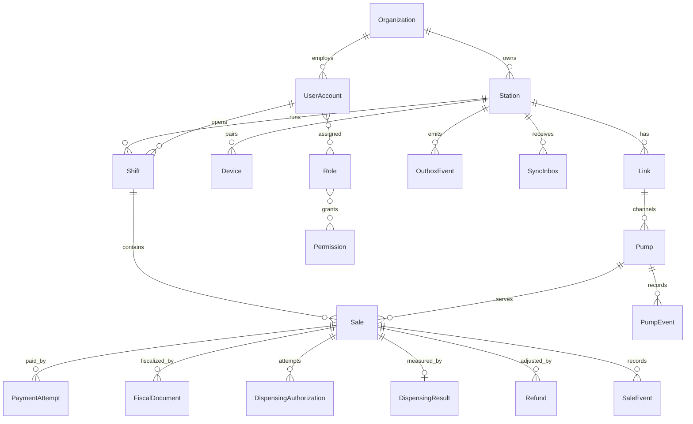

# База данных AGZS Control

Статус: локальная схема реализована миграцией кассы на этапе 2. Деньги — целые тенге. Миграции PostgreSQL относятся к этапу сервера.

Связанные документы: [архитектура](ARCHITECTURE.md), [продажа](SALES_FLOW.md), [риски](RISKS.md).

## 1. Две базы

| База | Движок | Роль |
| --- | --- | --- |
| Касса | SQLite, файл `{AGZS_DATA_DIR}/station.db` | Операционная база одной станции, включая очередь исходящих событий |
| Центр | PostgreSQL 16 | Учёт сети, копия коммерческих операций, пользователи, аудит, входящая идемпотентность |

Касса одностанционная: в операционных таблицах всё равно хранятся `organization_id` и `station_id`, чтобы событие синхронизации совпадало с моделью центра. В подробных списках полей ниже эти два идентификатора не повторяются у каждой таблицы, но в схеме кассы они есть у смен, продаж, оплат, фискальных документов, допусков, результатов отпуска, возвратов, аудита, инцидентов, событий колонок и outbox. Технический первичный ключ таких строк — UUID `id`, если ниже как ключ не назван другой столбец. `idempotency_key` остаётся уникальным отдельно.

Центр изолирует строки по `organization_id`. Прикладная роль работает под row-level security. Контекст организации устанавливается в начале транзакции запроса. Роль платформы отдельная и не используется кассовым токеном.

Удаление продаж, фискальных документов, платежей и аудита прикладной роли не выдаётся. Исправление ошибки оформляется компенсирующим событием.

## 2. Соглашения

- Первичные ключи — UUID. В SQLite это текст в каноническом виде. В PostgreSQL — тип `uuid`.
- Деньги — `INTEGER`, целые тенге (1 единица = 1 KZT), неотрицательные, если для поля не сказано иное. Тиын не хранится. Расхождение предоплаты и факта — знаковое поле `delta_kzt`: факт минус предоплата.
- Объём — `INTEGER`, миллилитры.
- Цена — `INTEGER`, тенге за литр.
- Время — `TIMESTAMPTZ` в PostgreSQL и текст ISO-8601 UTC в SQLite.
- Статусы — текст с проверкой `CHECK` по перечислениям из `shared`.
- Валюта первой версии — `KZT`. Поле валюты всё равно хранится.
- Секреты, PAN и данные дорожки карты в таблицы не пишутся. От платёжного терминала сохраняются статус, сумма, ключ идемпотентности и ссылка провайдера, если он её вернул.
- Журналы `pump_events`, `sale_events` и `audit_log` дополняются только вставкой. Каждая строка хранит `prev_hash` и `row_hash` (SHA-256 от предыдущего хеша и канонического JSON полезной нагрузки). Цепочка обнаруживает разрыв. Она не защищает от того, кто умеет переписать файл целиком; для этого нужны копия на центре и резервная копия.

Канонический JSON: UTF-8, ключи по алфавиту, без лишних пробелов, целые числа без дроби.

## 3. Логическая схема

На кассе нет таблиц `Organization` и входящего ящика центра: организация представлена идентификатором в строке станции. `OutboxEvent` есть только на кассе. `SyncInbox` есть только на центре.

## 4. Перечисления

Статусы колонки, как в требованиях:

`OFFLINE`, `IDLE`, `RESERVED`, `PAYMENT_PENDING`, `READY`, `DISPENSING`, `COMPLETED`, `STOPPED`, `ERROR`, `MAINTENANCE`.

Рядом хранится качество наблюдения: `CONFIRMED`, `STALE`, `UNKNOWN`. Если качество не `CONFIRMED` или снимок старше таймаута звена, публичный статус для решений — `OFFLINE`. Последний достоверный статус остаётся в журнале и не используется как разрешение на отпуск.

Оси продажи:

| Ось | Значения |
| --- | --- |
| Заказ | `DRAFT`, `OPEN`, `CLOSED`, `CANCELLED` |
| Оплата | `NONE`, `PENDING`, `CONFIRMED`, `FAILED`, `UNKNOWN`, `REVERSAL_PENDING`, `REVERSED` |
| Фискализация | `UNCONFIGURED`, `PENDING`, `PARTIAL`, `COMPLETED`, `FAILED`, `UNKNOWN` |
| Отпуск | `NOT_STARTED`, `AUTHORIZED`, `IN_PROGRESS`, `COMPLETED`, `STOPPED`, `FAILED`, `UNKNOWN` |
| Расхождение | `NOT_READY`, `BALANCED`, `ADJUSTMENT_REQUIRED`, `REFUND_PENDING`, `REFUND_COMPLETED` |
| Синхронизация | `NOT_QUEUED`, `PENDING`, `ACKED`, `REJECTED` |

`READY` у колонки означает, что программный допуск к пуску уже разрешён. Оплаченная, но ещё не выпущенная продажа держит колонку в `PAYMENT_PENDING`, а ось оплаты — в `CONFIRMED`. Так экран не показывает готовность к газу, пока шлюз закрыт.

## 5. Касса

### 5.1. Станция и оборудование

`station_profile` — одна строка.

| Поле | Смысл |
| --- | --- |
| `station_id` | Совпадает с центром |
| `organization_id` | Владелец |
| `code` | Короткий код в человекочитаемом номере продажи |
| `name` | Название |
| `timezone` | Имя IANA |
| `config_revision` | Последняя применённая ревизия центра |
| `sales_blocked` | Коммерческая блокировка новых продаж |
| `rounding_policy_id` | Пусто в промышленном профиле, пока политика не выбрана |
| `fiscal_policy_id` | Пусто, пока нет утверждённого правила |

`links` — звено эмулятора или будущей АСКА-02.

| Поле | Смысл |
| --- | --- |
| `id` | UUID |
| `driver` | `emulator` или `aska02` |
| `max_channels` | Сколько каналов разрешено опрашивать. У эмулятора равно числу созданных колонок. У АСКА-02 остаётся 0, пока акт не запишет фактическое число. Ёмкость модели — 6, это не значение по умолчанию для устройства |
| `passive_read_enabled` | Ложь, пока нет акта пассивных испытаний |
| `control_enabled` | Ложь, пока нет полного допуска |
| `protocol_id` | Пустая строка, пока инженер не записал подтверждённый идентификатор |
| `firmware_version` | Пустая строка до чтения с устройства |
| `config_json` | Параметры транспорта без секретов. Для эмулятора — число колонок и скорости. Для АСКА-02 до обследования — пустой объект |
| `consecutive_failures` | Подряд идущие сбои обмена. Успешный обмен сбрасывает счётчик |
| `unavailable` | Истина после порога сбоев или явного обрыва. Планировщик тогда ждёт интервал восстановления |

`pumps`

| Поле | Смысл |
| --- | --- |
| `id` | Внутренний UUID |
| `link_id` | Звено |
| `channel_no` | Номер канала на адаптере |
| `protocol_address` | Непрозрачный адрес. До протокола — строка, заданная конфигурацией эмулятора |
| `name` | Название на экране |
| `price_kzt_per_liter` | Текущая цена новых продаж |
| `status` | Публичный статус |
| `observation_quality` | Качество последнего снимка |
| `active_sale_id` | Текущая продажа или пусто |
| `maintenance_latched` | Техник оставил колонку в обслуживании; восстановление связи возвращает `MAINTENANCE`, а не `IDLE` |
| `status_changed_at` | Время перехода |
| `last_totalizer_ml` | Последний подтверждённый суммарный счётчик. При `UNKNOWN` экран его не показывает |
| `last_dose_ml` | Последняя подтверждённая доза. Пусто, если дозы нет или наблюдение потеряно |
| `last_fault_code` | Код последней подтверждённой аварии |
| `last_observed_at` | Когда снимок последний раз записан |

Уникальность: `(link_id, channel_no)` и `(link_id, protocol_address)`.

`pump_events` — переходы, аварии, старт и финиш отпуска, редкие снимки телеметрии во время отпуска. Каждый опрос в журнал не пишется.

### 5.2. Люди и смены

`users` — локальный кэш пользователей станции: идентификатор, имя, хеш Argon2id, признак активности, версия roster.

`roles`, `permissions`, `user_roles` — тот же смысл, что на центре, в объёме, нужном кассе.

`shifts`

| Поле | Смысл |
| --- | --- |
| `id` | UUID |
| `user_id` | Кто открыл |
| `number` | Монотонный номер смены станции |
| `status` | `OPEN` или `CLOSED` |
| `opened_at`, `closed_at` | Границы |
| `opening_cash_kzt`, `closing_cash_kzt` | Учёт наличных, если смена их фиксирует |

Одновременно открыта не больше одной смены.

`audit_log` — кто, когда, какое действие, идентификатор объекта, результат. Сюда попадают вход, отказ доступа, смена цены, блокировка продаж, попытка недопустимой команды колонке, ручной повтор.

`incidents` — сообщения для журнала ошибок кассира: код, серьёзность, текст, `sale_id` или `pump_id`, время, признак квитирования. Это проекция, а не второй источник истины.

### 5.3. Продажа

`number_sequences` — имя счётчика и значение. Номер продажи берётся в той же транзакции, что и вставка продажи. Счётчик не сбрасывается в полночь.

Человекочитаемый номер: `{station_code}-{YYYYMMDD}-{sequence}`. Дата — локальная календарная дата станции. Уникален сам номер. При сдвиге часов назад последовательность всё равно растёт.

`sales`

| Поле | Смысл |
| --- | --- |
| `id` | `sale_id`, создаётся до обращения к терминалу |
| `shift_id`, `pump_id` | Контекст |
| `display_number` | Номер для человека |
| шесть осей статуса | См. таблицу перечислений |
| `prepaid_kzt` | Заданная предоплата |
| `unit_price_kzt_per_liter` | Цена, замороженная в момент создания |
| `rounding_policy_id` | Политика, действовавшая в момент создания |
| `delivered_ml` | Пусто, пока факт неизвестен |
| `actual_kzt` | Пусто, пока факт нельзя посчитать |
| `delta_kzt` | Факт минус предоплата; пусто, пока нет факта |
| `fiscal_policy_id` | Правило, выбранное в момент шлюза |
| `version` | Оптимистическая блокировка |

`sale_events` — каждое изменение осей: прежнее значение, новое, причина, ссылка на попытку оплаты, документ или допуск.

`payment_attempts`

| Поле | Смысл |
| --- | --- |
| `id` | UUID попытки |
| `sale_id` | Продажа |
| `attempt_no` | С 1 |
| `idempotency_key` | Уникальный ключ обращения к провайдеру |
| `status` | `CREATED`, `SENT`, `CONFIRMED`, `FAILED`, `UNKNOWN` |
| `amount_kzt` | Сумма попытки |
| `provider` | Имя адаптера, для боевого контура `kaspi_smart_pos` |
| `provider_reference` | Ссылка терминала, если уже получена |
| `created_at`, `updated_at` | Границы |

Ограничения: уникальны `(sale_id, attempt_no)` и `idempotency_key`. Частичный уникальный индекс: не больше одной строки `CONFIRMED` на `sale_id`. Новая попытка допустима, только если предыдущая в `FAILED`. Статусы `SENT` и `UNKNOWN` новую попытку запрещают.

`fiscal_documents`

| Поле | Смысл |
| --- | --- |
| `sale_id` | Продажа |
| `step_code` | Идентификатор шага из утверждённого правила, а не свободное описание чека |
| `idempotency_key` | Ключ сдачи в Webkassa |
| `status` | `CREATED`, `SUBMITTING`, `ISSUED`, `FAILED`, `UNKNOWN` |
| `provider_document_id` | Номер документа провайдера после успеха |
| `request_hash`, `response_hash` | Контроль содержимого без хранения лишних персональных данных |

Уникальны `idempotency_key` и пара `(sale_id, step_code)` среди статусов `SUBMITTING`, `ISSUED`, `UNKNOWN`. Повторная сдача того же шага запрещена, пока сверка не переведёт `UNKNOWN` в окончательный статус.

`dispensing_authorizations`

| Поле | Смысл |
| --- | --- |
| `sale_id`, `pump_id` | Что и где |
| `attempt_no` | С 1 |
| `idempotency_key` | Ключ команды |
| `status` | `CREATED`, `SENT`, `ACKNOWLEDGED`, `REJECTED`, `UNKNOWN` |
| `authorized_kzt` | Сумма допуска, равна замороженной предоплате |
| `totalizer_start_ml` | Счётчик в момент подтверждённого допуска; пусто, если чтение не удалось |

Частичный уникальный индекс: одна строка `ACKNOWLEDGED` на продажу. Повтор после `REJECTED` возможен только действием кассира. После `SENT` или `UNKNOWN` повтор запрещён до сверки.

`dispensing_results` — не больше одной строки на продажу: ссылка на допуск, конечный счётчик, `delivered_ml`, `actual_kzt`, причина завершения `COMPLETED`, `STOPPED`, `ERROR` или `UNKNOWN`.

`refunds` — намерение урегулировать расхождение. Сумма `amount_kzt`, причина, статус `CREATED`, `PENDING`, `COMPLETED`, `FAILED`, `NOT_SUPPORTED`, собственный ключ идемпотентности и `fiscal_policy_id`. Наличие строки не означает, что деньги уже возвращены.

### 5.4. Доставка и служебные таблицы

`outbox`

| Поле | Смысл |
| --- | --- |
| `event_id` | Первичный ключ события |
| `station_sequence` | Монотонный номер станции |
| `event_type`, `schema_version` | Контракт |
| `payload_json` | Тело |
| `created_at` | Когда зафиксировано |
| `published_at` | Пусто, пока центр не подтвердил |
| `attempt_count`, `next_attempt_at`, `last_error` | Повтор с увеличением паузы |

Запись outbox вставляется в той же транзакции, что и изменение продажи, смены или аудита, которое она отражает. Доставщик помечает `published_at` только после `ACK` или `DUPLICATE`.

`sync_state` — последняя подтверждённая последовательность и последняя применённая ревизия конфигурации.

Настройки приложения, не являющиеся секретами, лежат в `settings`.

## 6. Центр

Сущности требований отображаются так:

| Сущность | Таблица | Примечание |
| --- | --- | --- |
| Organization | `organizations` | Название, статус |
| Station | `stations` | Организация, код, часовой пояс, блокировка продаж, ревизия |
| Pump | `pumps` | Реестр и последний известный статус. Это наблюдение, не канал управления |
| User | `users` | Учётные записи людей |
| Role | `roles`, `role_permissions`, `user_role_assignments` | RBAC, назначение в рамках организации |
| Shift | `shifts` | Копия смены |
| Sale | `sales` | Копия продажи, ключ — исходный `sale_id` |
| Payment | `payments` | Копии попыток |
| FiscalReceipt | `fiscal_receipts` | Копии фискальных документов |
| Dispensing | `dispensings` | Допуск и результат |
| Refund | `refunds` | Копии урегулирования |
| AuditLog | `audit_log` | Действия офиса и принятые события аудита станции |
| Device | `devices` | Станция, хеш токена, срок, отзыв |
| SyncEvent | `sync_inbox` | Идемпотентность приёма |

Дополнительно:

- `pairing_codes` — одноразовый код сопряжения, срок жизни, погашение;
- `price_versions` — цена колонки, ревизия, момент начала действия;
- `heartbeats` — последний пульс станции: версия ПО, драйвер, глубина outbox, качество звена, снимок статусов колонок;
- `config_changes` — исходящая станции ревизия конфигурации.

`sync_inbox` уникален по `(station_id, event_id)`. В строке хранится хеш тела. Повтор с тем же хешем — `DUPLICATE`. Повтор с другим хешем — `REJECTED` и запись в аудит.

Коммерческие таблицы центра содержат исходные идентификаторы кассы, а не новые ключи, чтобы повторная пачка сошлась со старой строкой.

## 7. Что переезжает между контурами

С кассы в центр: смены, продажи, попытки оплаты, фискальные документы, допуски, результаты отпуска, возвраты, аудит критических действий, события колонок уровня аварии.

Из центра на кассу: ревизия станции, цены, кэш пользователей и ролей, флаг блокировки продаж, идентификаторы политик округления и фискализации, которые уже есть в установленной версии программы.

Не переезжает ни в одну сторону: кадры колонки, команды пуска и останова, секреты Webkassa, секреты Kaspi, открытый токен устройства.

Цена из новой ревизии применяется только к продажам, созданным после неё. Открытая продажа сохраняет `unit_price_kzt_per_liter`.

## 8. Индексы

Касса:

- `sales (shift_id, created_at)`;
- `sales (pump_id, order_status)`;
- `outbox (published_at, next_attempt_at)`;
- `payment_attempts (provider_reference)`;
- частичные уникальные индексы из раздела продажи.

Центр:

- все коммерческие таблицы: `(organization_id, station_id, created_at)`;
- уникальность `sales (station_id, display_number)`;
- `heartbeats (station_id)` как последняя точка плюс история по времени для разбора;
- `sync_inbox (station_id, station_sequence)`.

Этого достаточно для сети из сотен станций. Секционирование по месяцу рассматривается только после замера.

## 9. Миграции и целостность

У кассы и у центра разные каталоги Alembic. Общие перечисления импортируются из `shared`, а не копируются вручную.

SQLite включается с `foreign_keys=ON`, `journal_mode=WAL` и `busy_timeout`. Пишет один рабочий поток. Чтение для интерфейса использует короткие отдельные соединения.

Восстановление кассы после обрыва питания:

1. Не отправлять повторно допуск со статусом `SENT` или `UNKNOWN`.
2. Оплату в `SENT` или `UNKNOWN` только запрашивать у провайдера.
3. Фискальный документ в `SUBMITTING` или `UNKNOWN` только сверять.
4. Неподтверждённый outbox отправлять снова: приём на центре идемпотентный.
5. Если счётчик колонки прочитать нельзя, не вычислять сумму факта.

Проверка цепочки хешей выполняется при открытии смены и по запросу администратора. Разрыв создаёт инцидент и не чинится пересчётом задним числом.

Ежедневная копия SQLite снимается штатным API резервного копирования, а не копированием файла в момент записи. Каталог копий — `{AGZS_DATA_DIR}/backups/`.

На центре ежедневный дамп и архив WAL описываются в [ARCHITECTURE.md](ARCHITECTURE.md). Роль приложения не владеет правом удалять таблицы аудита и фискальных документов.
