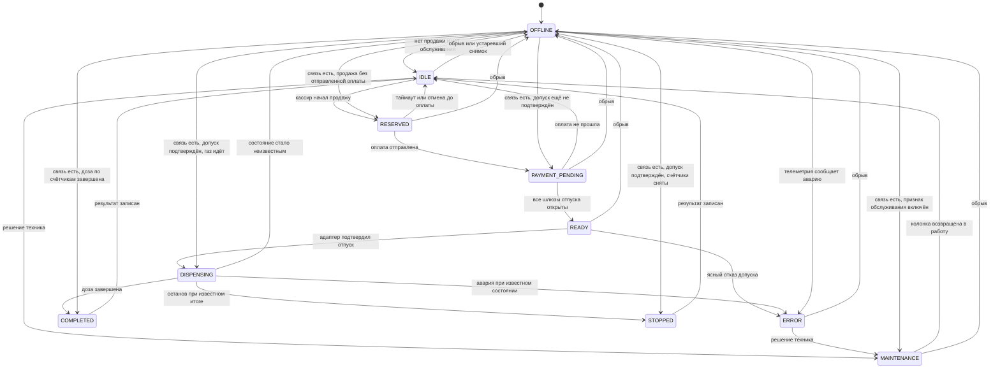

# Колонки, эмулятор и будущая АСКА-02

Статус: этап 1. Протокол адаптера АСКА-02 не выбран и не описывается. Документ фиксирует программную границу, автомат состояний и порядок допуска после появления устройства.

Связанные документы: [архитектура](ARCHITECTURE.md), [продажа](SALES_FLOW.md), [план](DEVELOPMENT_ROADMAP.md).

## 1. Что уже известно

На станции планируются газовые колонки УЗСГ-01 и адаптер связи АСКА-02. Адаптера в проекте сейчас нет. Количество каналов на одном адаптере документально не зафиксировано. Проектный ориентир очереди и конфигурации — 6 каналов. Это не паспорт устройства.

Название «Искра 1.72» не считается протоколом этой АСКА-02. Его нельзя записывать в `protocol_id`, использовать в разборе кадров и класть в тесты совместимости. Идентификатор протокола и версия прошивки заполняются только после чтения документации и самого устройства.

Не фиксируются и не выдумываются: распиновка, скорость порта, тип физического канала, адреса, формат кадра, коды команд, смысл битов состояния, масштаб счётчика, реакция на обрыв.

Команды калибровки и изменения метрологических коэффициентов в интерфейс адаптера не входят.

## 2. Инварианты безопасности

1. Первый обмен с физическим устройством — пассивное чтение состояния и счётчиков на стенде, без подачи газа и без команд пуска.
2. `authorize` и любой программный останов не вызываются на АСКА-02, пока в записи звена не стоят оба флага: пассивные испытания пройдены и управление отдельно разрешено.
3. Разрешение управления — локальная административная запись после акта. Центр такой флаг включить не может.
4. Аппаратный аварийный останов остаётся на оборудовании. Экранная кнопка до отдельного подтверждения протокола только запрещает новые программные команды и показывает инструкцию воспользоваться аппаратной кнопкой.
5. Неизвестное состояние закрывает отпуск так же, как обрыв связи.
6. Эмулятор не открывает последовательный порт, сокет устройства и любой другой канал, который может вести к УЗСГ-01 или АСКА-02.

Заглушка `Aska02Adapter` реализует тот же порт, что и эмулятор, и на каждом методе возвращает отказ «обмен не допущен». В ней нет байтов протокола. Появление устройства — повод заменить внутренность адаптера, а не сценарий продажи.

## 3. Колонка в программе

У каждой колонки есть:

| Свойство | Назначение |
| --- | --- |
| `id` | Постоянный внутренний идентификатор |
| `protocol_address` | Адрес на звене. Для эмулятора назначается конфигурацией. Для АСКА-02 остаётся пустым до протокола |
| `channel_no` | Номер канала адаптера |
| `name` | Подпись на экране |
| `price_kzt_per_liter` | Цена новой продажи, целые тенге за литр |
| `status` | Текущий публичный статус |
| `observation_quality` | `CONFIRMED`, `STALE` или `UNKNOWN` |
| активная продажа | Не больше одной |
| заданная сумма | Предоплата активной продажи |
| отпущенный объём | Из дельты счётчика, когда она известна |
| итоговая стоимость | После применения политики округления |
| журнал | `pump_events` |

Состояния независимы. Занятость одной колонки не переводит остальные в тот же статус.

## 4. Автомат

`READY` ставится только сценарием продажи после шлюзов из [SALES_FLOW.md](SALES_FLOW.md). Менеджер колонок сам в `READY` колонку не переводит. После обрыва колонка в `READY` восстанавливается в `PAYMENT_PENDING`, пока допуск не подтверждён: новый пуск сам не ставится.

Возврат из `OFFLINE` в `IDLE` выполняется, когда активной продажи нет, признак обслуживания выключен и телеметрия показывает свободную колонку. Начатая продажа удерживает колонку.

| Что видно после восстановления | Куда возвращается колонка |
| --- | --- |
| Активной продажи нет, обслуживание не запрошено, телеметрия свободна | `IDLE` |
| Признак обслуживания включён, активной продажи нет, телеметрия читается | `MAINTENANCE` |
| Оплата ещё не завершена или допуск ещё не подтверждён, телеметрия физически свободна | Прежний `RESERVED` или `PAYMENT_PENDING` по осям продажи |
| Допуск подтверждён, телеметрия показывает отпуск | `DISPENSING` |
| Допуск подтверждён, телеметрия спокойна, оба счётчика читаются | `STOPPED` или `COMPLETED` по объёму, затем обычное закрытие |
| Телеметрия сообщает аварию | `ERROR` |
| Счётчик или статус прочитать нельзя | Остаётся `OFFLINE` |

Новый допуск при таком восстановлении не отправляется.

Переход вне схемы отклоняется и пишется в журнал. Телеметрию принимает менеджер: адаптер сам статус продажи не меняет.

Таймаут резерва без старта оплаты предлагается равным 120 секундам и выносится в настройку. Оплата в `PENDING` или `UNKNOWN` этим таймаутом не отменяется.

Пока наблюдение не `CONFIRMED`, для логики допуска статус считается `OFFLINE`, даже если в журнале последним достоверным был `IDLE`.

## 5. Несколько колонок на одном звене

Одно звено — один физический адаптер и один секвенсор. Колонка принадлежит ровно одному звену. Станция может иметь несколько звеньев; их секвенсоры не делят очередь.

Секвенсор держит не больше одной незавершённой транзакции обмена. Пока транзакция ждёт ответа, следующая команда любой колонки этого звена стоит в очереди. Логические отпуски при этом идут одновременно: колонка A уже в `DISPENSING`, колонка B получает свой допуск, когда шина освободится.

Порядок выбора работы:

1. Защёлка программной блокировки новых команд.
2. Опрос колонок, которые уже отпускают газ.
3. Команда управления, если она разрешена флагами звена и автоматом.
4. Опрос спокойных колонок по кругу.
5. Чтение суммарного счётчика по расписанию и обязательно в точках допуска и завершения.

Интервалы опроса — свойство программного планировщика, а не параметр АСКА-02. Стартовые значения для эмулятора: 200 мс для колонки в отпуске, 500 мс для спокойной, 2 с для попытки восстановить упавшее звено. Реальный адаптер позже добавит обязательную паузу внутри своей транзакции, если это потребует документация. Секвенсор от этой паузы не становится параллельным.

Таймаут одной транзакции увеличивает счётчик сбоев звена. После порога звено помечается недоступным, колонки уходят в `OFFLINE`, качество — в `UNKNOWN`. Порог — настройка, стартовое значение 3 подряд.

Конфликт команд снимается дважды. Автомат колонки отклоняет незаконный переход. Секвенсор отклоняет вторую команду управления той же колонки, пока первая не в окончательном статусе `ACKNOWLEDGED` или `REJECTED`. Статус `UNKNOWN` очередь не «доотправляет».

Команда управления сохраняется в базе до передачи адаптеру. После перезапуска процесс поднимает её как `UNKNOWN` или `SENT` и не создаёт новую, пока сверка чтением не объяснит, принята ли она. Для АСКА-02 такая сверка появится только вместе с пассивным чтением. Для эмулятора сверка определена: эмулятор хранит последний `command_id`.

## 6. Порт адаптера

Оба адаптера реализуют один порт.

| Операция | Смысл | Эмулятор | АСКА-02 до допуска |
| --- | --- | --- | --- |
| `probe` | Живо ли звено | Состояние модели | Отказ |
| `read_status` | Статус и текущий объём | Снимок модели | Отказ, пока не включено пассивное чтение |
| `read_totalizer` | Суммарный счётчик | Счётчик модели | Отказ, пока не включено пассивное чтение |
| `authorize` | Разрешить отпуск заданной суммы | Исполняет в модели | Всегда отказ |
| `read_authorization` | Сверить ранее отправленный допуск | По `command_id` | Отказ |

Результат адаптера — подтверждение, ясный отказ или неизвестность. Исключение и таймаут менеджер превращает в неизвестность, а не в отказ «газ не пошёл»: отказ разрешил бы повтор, неизвестность его запрещает.

Адрес и номер канала адаптер воспринимает как непрозрачные поля команды. Проверку диапазона каналов делает менеджер по `max_channels` звена.

## 7. Эмулятор

`EmulatorAdapter` создаёт виртуальные колонки в памяти процесса. Конструктор не принимает имя последовательного порта и сетевой адрес устройства. Тест сборки ищет у эмулятора обращения к портам и к каталогу `/dev` и должен оставаться пустым.

В профиле `emulator` можно:

- задать число колонок от 1 до 6;
- включать и выключать отдельную колонку;
- задавать скорость отпуска в миллилитрах в секунду;
- обрывать звено целиком или одну колонку;
- вводить аварию с кодом для журнала;
- останавливать отпуск раньше суммы;
- вести несколько колонок в `DISPENSING` одновременно.

Модель каждой колонки хранит суммарный счётчик. Пока колонка «отпускает», счётчик растёт со скоростью сценария и не превышает сумму допуска при испытательном округлении `TEST_HALF_UP`. Пока звено оборвано, внутренний счётчик продолжает расти, а чтение возвращает `UNKNOWN` и скрывает объём; после восстановления виден догнанный объём. Тесты могут подменить часы. Окончание по сумме переводит телеметрию в завершённую дозу. Авария и ранний останов замораживают счётчик. Повтор того же `command_id` не открывает вторую дозу.

Эмулятор — источник телеметрии только для своих виртуальных колонок. Промышленный корень сборки его не создаёт.

Окно эмулятора на кассе управляет этими тестовыми воздействиями через сценарий. Оно не появляется при `AGZS_ENV=production`.

## 8. План работ после получения АСКА-02

Работы начинаются отдельным этапом и не смешиваются с эмулятором.

1. Принять устройство, паспорт, схему подключения и описание протокола той партии, которая пришла. Зафиксировать заводской номер и заявленную версию прошивки в акте, а не в коде «по памяти».
2. Определить физический интерфейс по документам поставщика. Не подбирать распиновку перебором.
3. Снять фактическую версию прошивки способом, который описан в документации устройства.
4. Заполнить `protocol_id` и `firmware_version` строками из этих источников. Если документ и устройство расходятся, обмен не включать.
5. На стенде без отпуска газа включить только пассивное чтение одной колонки. Сравнивать прочитанное состояние с индикацией самой колонки.
6. Повторить чтение для каждого реально присутствующего канала. Записать фактическое число каналов в `max_channels`. Каналы сверх факта не опрашивать.
7. Прогнать контрактные тесты порта: таймаут, повторное чтение, неизвестный адрес, обрыв, отсутствие лишней записи в линию во время чтения.
8. Отдельно подтвердить аппаратные защиты: локальный аварийный останов, поведение при пропадании питания, отсутствие самопуска после включения компьютера.
9. Только после пунктов 1–8 и письменного допуска рассматривать команды пуска и останова. Первые такие команды — на стенде, с закрытой подачей газа, одной колонкой, с заранее сохранённым стартовым счётчиком.
10. Совместить результат стенда с уже идущими продажами эмулятора: тот же `PumpManager` и те же тесты автомата, другой адаптер.

Пока пункт 9 не закрыт, `control_enabled` остаётся ложью, даже если пассивное чтение уже полезно для мониторинга.

Откат на любом шаге — выключение флагов звена. Эмулятор при этом не подменяет боевой драйвер в промышленном профиле: касса либо читает реальное звено, либо явно работает в учебном профиле без устройства.

## 9. Критерии приёмки драйвера

Пассивный режим принимается, если на стенде чтение устойчиво показывает состояние и счётчик, совпадающие с колонкой, не изменяет её режим и корректно переходит в `UNKNOWN` при отключении кабеля.

Режим управления рассматривается только когда дополнительно выполнено всё из списка:

- протокол и прошивка записаны по факту устройства;
- команда пуска на стенде без газа не приводит к самопроизвольному пуску на других каналах;
- повтор той же команды не даёт второй дозы;
- обрыв ответа не выглядит как успешный пуск;
- аппаратный останов проверен независимо от программы;
- в журнале есть акт с датой, номером устройства и фамилиями участников испытания.

До выполнения списка реализация `authorize` в `Aska02Adapter` остаётся отказом.
