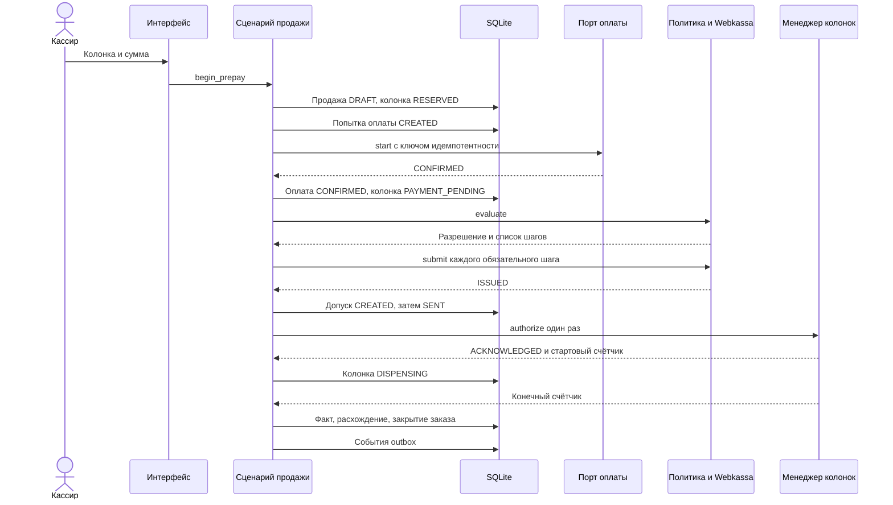

# Жизненный цикл продажи

Статус: этап 1. Документ задаёт состояния и запреты. Он не утверждает налоговую схему предоплаты, состав чеков Webkassa и порядок возврата денег покупателю.

Связанные документы: [архитектура](ARCHITECTURE.md), [база данных](DATABASE.md), [колонки](PUMP_PROTOCOL.md).

## 1. Как устроена операция

Продажа — одна агрегатная запись с шестью независимыми осями.

| Ось | Вопрос, на который она отвечает |
| --- | --- |
| Заказ | Создана ли операция и закрыта ли она для кассира |
| Оплата | Подтвердил ли Kaspi Smart POS именно эту сумму |
| Фискализация | Выполнены ли шаги утверждённой политики |
| Отпуск | Был ли один подтверждённый допуск и чем закончился газ |
| Расхождение | Совпали ли предоплата и фактическая стоимость |
| Синхронизация | Принял ли центр события без искажения |

Колонка имеет собственный статус. Он связан с продажей, но не заменяет оси. Например, оплата уже `CONFIRMED`, а колонка ещё `PAYMENT_PENDING`, потому что фискальный шлюз отпуск не открыл.

Цена копируется в продажу при создании. Дальнейшая смена цены колонки эту продажу не меняет.

Идентификатор `sale_id` создаётся на кассе до первого обращения к терминалу.

## 2. Шлюзы

Отпуск разрешается только если одновременно выполнено всё ниже.

1. Смена открыта, станция не в коммерческой блокировке.
2. Колонка в `PAYMENT_PENDING`, качество наблюдения `CONFIRMED`, снимок свежий.
3. Оплата этой продажи `CONFIRMED`, подтверждённая сумма равна предоплате.
4. Нет другой подтверждённой оплаты той же продажи.
5. Фискальная политика вернула разрешение. Встроенное правило `DENY_ALL` разрешение не возвращает.
6. Нет допуска в статусе `ACKNOWLEDGED`, `SENT` или `UNKNOWN`.
7. Звено колонок исправно, драйвер имеет право управления. У АСКА-02 до акта допуска этого права нет.
8. Задана политика округления. В промышленном профиле пустая политика продажу не создаёт.
9. Сумма предоплаты больше нуля.

Отказ любого пункта оставляет колонку без статуса `READY` и не вызывает `authorize`.

Эмулятор в профиле `emulator` может работать с тестовой политикой, которая явно разрешает отпуск без Webkassa. Такая политика не регистрируется при `AGZS_ENV=production`. Окно эмулятора показывает, что операция учебная.

## 3. Основной сценарий предоплаты

Сценарий ниже описывает успешный путь **после** того, как будут утверждены политика фискализации, контракт Kaspi и допуск драйвера колонок. До этого шаги 6–8 останавливаются на закрытом шлюзе. Для эмулятора шаги колонки исполняет `EmulatorAdapter`.

Пошагово:

1. Кассир выбирает колонку в `IDLE`.
2. Вводит сумму предоплаты. Сценарий создаёт продажу и переводит колонку в `RESERVED`.
3. Создаётся попытка оплаты в `CREATED`, затем вызывается порт Kaspi. Статус становится `SENT`, колонка — `PAYMENT_PENDING`, заказ — `OPEN`.
4. Успешный ответ сверяется с суммой и ключом. Только тогда оплата становится `CONFIRMED`.
5. Повторный ответ с тем же ключом не создаёт вторую попытку.
6. Политика фискализации решает, нужны ли документы до отпуска. Нужные документы сдаются своими ключами. Статус `ISSUED` ставится после ответа Webkassa.
7. Если все обязательные условия раздела 2 выполнены, колонка переходит в `READY`, создаётся один допуск и один вызов `authorize`.
8. Подтверждённый допуск сохраняет стартовый суммарный счётчик. Колонка переходит в `DISPENSING`, когда адаптер сообщает отпуск.
9. Окончание фиксирует конечный счётчик. Объём — разность счётчиков. Стоимость считается целой арифметикой замороженной цены и выбранной политики округления.
10. Ось расхождения заполняется по правилам раздела 5. Программа не объявляет возврат завершённым, если ось возврата этого не говорит.
11. Заказ становится `CLOSED`, когда отпуск завершён и дальнейший пуск по этой продаже невозможен. Расхождение может остаться открытым отдельной осью.
12. Колонка возвращается в `IDLE` после записи результата, если нет аварии.
13. Та же транзакция пишет outbox. Связь с центром на этот сценарий не влияет.
14. Доставщик передаёт события. Повторная пачка получает `DUPLICATE`.

## 4. Оплата

Перед внешним вызовом строка попытки уже лежит в базе.

| Ситуация | Поведение |
| --- | --- |
| Отказ терминала | Попытка `FAILED`, оплата `FAILED`, заказ `CANCELLED`, колонка `IDLE` |
| Нет связи с терминалом до подтверждения отправки | Попытка остаётся `CREATED`, деньги не считаются списанными, отпуск закрыт |
| Запрос ушёл, ответа нет | `UNKNOWN`. Новый старт оплаты запрещён. Доступен только `query` тем же ключом |
| `query` подтвердил успех | Одна оплата `CONFIRMED` |
| `query` подтвердил отказ | Как отказ терминала |
| Повторный клик «оплатить» | Возвращается текущая попытка |
| Сумма ответа не равна предоплате | `UNKNOWN` и инцидент, отпуск закрыт |

Если контракт Kaspi не умеет запрос статуса, попытка без ответа остаётся `UNKNOWN` до ручной сверки. Вторая попытка в этом состоянии не создаётся. Это сознательная остановка продажи, а не обходной успех.

Отмена после `CONFIRMED` не прячет оплату. Если провайдер поддерживает реверс, сценарий вызывает его тем же принципом идемпотентности. Если не поддерживает, ось оплаты остаётся `CONFIRMED`, а ось расхождения переходит к урегулированию. Самовольный сценарий возврата на карту не добавляется.

Номера карт в журнал и базу не записываются.

## 5. Фискализация и расхождение сумм

Политика — код с идентификатором правила плюс запись о том, кто его утвердил вне программы. Конфигурация станции только выбирает идентификатор. Неизвестный идентификатор обрабатывается как `DENY_ALL`.

До утверждения бухгалтером и Webkassa в системе нет правила, которое считает один чек достаточным, и нет правила, которое дробит предоплату на аванс и добор. Место для такого правила есть: `steps_for` возвращает конкретные `step_code`, а адаптер Webkassa сдаёт ровно их.

Расхождение считается только при известном объёме.

| Факт | Ось расхождения |
| --- | --- |
| Фактическая стоимость равна предоплате | `BALANCED` |
| Фактическая стоимость меньше предоплаты | `ADJUSTMENT_REQUIRED`, дельта сохранена |
| Объём неизвестен | Расхождение остаётся `NOT_READY`, заказ не маскируется под закрытый расчёт |
| Фактическая стоимость больше предоплаты | Инцидент, колонка `ERROR`, новая продажа на ней остановлена. Доплата сама не запускается |

Для `ADJUSTMENT_REQUIRED` политика позже может создать шаги фискализации и строку `refunds`. Пока такого правила нет, касса показывает долг расхождения и не помечает его возвращённым. Закрытие смены при открытых расхождениях допускается: исключение остаётся в очереди станции и в отчёте. Новая продажа на свободной колонке из-за старого расхождения не блокируется. Это рабочее решение; если учёт потребует запрет закрытия смены, меняется только эта проверка.

Нулевой отпуск после успешной оплаты — частный случай меньшей суммы: весь объём предоплаты становится расхождением, газ повторно не пускается.

## 6. Отпуск

Допуск создаётся строкой `CREATED` до вызова адаптера. Затем `SENT`. Ответ делит три исхода:

| Ответ | Дальше |
| --- | --- |
| Подтверждение | `ACKNOWLEDGED`, старт счётчика, колонка может перейти в `DISPENSING` |
| Ясный отказ | `REJECTED`. Кассир может явно запросить новую попытку |
| Обрыв или непонятный ответ | `UNKNOWN`. Новый `authorize` запрещён, колонка `OFFLINE`, пока чтение состояния не восстановит факт |

Во время отпуска интерфейс показывает литры и сумму из телеметрии. В расчёт продажи они не записываются как окончательные, пока нет результата со счётчиками.

Останов покупателем или аппаратный останов при известном конечном счётчике даёт ось отпуска `STOPPED` и дальше обычное сравнение сумм. Программа до аппаратного допуска не посылает собственную команду останова. Кнопка на экране ставит программную защёлку «новые команды не слать» и напоминает про аппаратный останов.

Потеря связи в ходе отпуска переводит наблюдение в `UNKNOWN`. Последний объём на экране помечается устаревшим. После восстановления факт снимается пассивным чтением счётчика, если допуск уже был подтверждён и стартовый счётчик сохранён. Если стартового счётчика нет, сумма факта не вычисляется.

Несколько колонок проходят этот сценарий независимо. Секвенсор звена упорядочивает только обмен. Две продажи не делят попытку оплаты и допуск.

## 7. Защита от повторов

| Повтор | Механизм |
| --- | --- |
| Второй захват колонки | Колонка не `IDLE` |
| Второе списание | Одна подтверждённая попытка на `sale_id`; неизвестная попытка блокирует новую |
| Второй чек того же шага | Уникальность `(sale_id, step_code)` для незавершённо-отправленных и выпущенных документов; сверка вместо новой сдачи |
| Второй пуск | Одна запись `ACKNOWLEDGED`; `UNKNOWN` блокирует новый допуск |
| Вторая доставка на центр | `(station_id, event_id)` и сравнение хеша тела |
| Повторное нажатие в интерфейсе | Сценарий возвращает текущую продажу |

Ключи строятся из `station_id`, `sale_id`, вида операции и номера попытки. Случайный ключ без этой связи не используется: после перезапуска касса обязана получить тот же ключ из строки попытки.

## 8. Смена

Открытие смены доступно роли с соответствующим разрешением. Продажа без открытой смены не создаётся.

Закрытие смены запрещено, если на станции есть продажа с оплатой `PENDING` или `UNKNOWN`, с отпуском `AUTHORIZED`, `IN_PROGRESS` или `UNKNOWN`, либо колонка в `DISPENSING` или `READY`. Кассир сначала дожидается сверки или переводит колонку в обслуживание по отдельной процедуре, если оборудование требует ремонта.

Закрытая смена новые продажи не принимает. Её события уходят в outbox и могут быть доставлены позже.

## 9. Офлайн

| Доступность | Продажа |
| --- | --- |
| Центр недоступен, Kaspi и колонка доступны, фискальный шлюз по утверждённой политике пройден | Продажа завершается локально, события ждут outbox |
| Kaspi недоступен или оплата не подтверждена | Отпуск запрещён |
| Колонка недоступна или статус неизвестен | Отпуск запрещён |
| Webkassa нужна выбранной политике и недоступна | Шлюз закрыт, уже начатый запрос только сверяется |
| Политика не утверждена | Шлюз закрыт в любом режиме сети |

Локальная продажа остаётся полной: повторная отправка не создаёт вторую оплату и второй чек, потому что внешние вызовы привязаны к уже сохранённым попыткам, а центр принимает событие один раз.

## 10. Что должен подтвердить внешний специалист

До реализации боевых веток нужны письменные ответы, а не значения по умолчанию:

- какие документы Webkassa формируются до отпуска, после отпуска и при сумме факта меньше предоплаты;
- что делать с нулевым отпуском и с остатком предоплаты;
- поддерживает ли выбранный способ подключения Kaspi Smart POS запрос статуса и отмену;
- какая политика округления обязательна для литра и тенге;
- можно ли закрывать смену с незакрытым расхождением.

Пока ответа нет, соответствующая ветка остаётся закрытой: `DENY_ALL`, запрет второй попытки, отсутствие автоматического возврата.
